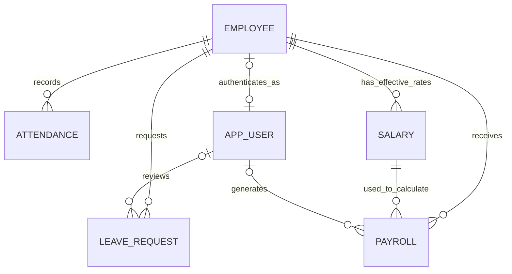

# Phase 1 — Payroll & Attendance data model

## ER model and cardinalities

`APP_USER` extends the required domain entities to support the required roles. An employee may have one employee login; HR/Admin users have no employee FK. Payroll points to the salary row used for that pay period, preserving calculation history if a salary changes later.

## Relational schema (the canonical Phase 1 schema)

- **EMPLOYEE**(`employee_id` PK, first_name, last_name, department, job_title, email UNIQUE, hire_date, active)
- **APP_USER**(`user_id` PK, `employee_id` FK UNIQUE nullable, email UNIQUE, password_hash, role, active)
- **ATTENDANCE**(`attendance_id` PK, `employee_id` FK, work_date, check_in, check_out, status, notes, UNIQUE(employee_id, work_date))
- **LEAVE_REQUEST**(`leave_id` PK, `employee_id` FK, start_date, end_date, leave_type, reason, status, `reviewed_by` FK nullable, reviewed_at, created_at)
- **SALARY**(`salary_id` PK, `employee_id` FK, effective_from, effective_to nullable, base_monthly, allowance_monthly, tax_rate, UNIQUE(employee_id, effective_from))
- **PAYROLL**(`payroll_id` PK, `employee_id` FK, `salary_id` FK, period_start, period_end, base_pay, allowance, unpaid_deduction, tax_deduction, gross_pay, net_pay, generated_at, `generated_by` FK nullable, UNIQUE(employee_id, period_start))

The authoritative column types, constraints, procedure, triggers, view, and indexes are defined in `../sql/01_schema.sql` and consumed unchanged by the seed, API, and report SQL.

## Normalization notes

- **1NF:** Attributes are scalar; attendance is one employee/date row, and leave ranges are separate rows. Repeating monthly attendance or salary columns are not embedded in employee.
- **2NF:** Each non-key fact in attendance, leave, salary, and payroll depends on its table’s whole key. In particular, payroll is uniquely identified by employee and period, while salary history is keyed by salary_id with a unique employee/effective date.
- **3NF:** Employee department/contact/job details are stored once on Employee; account credentials and role are isolated in App_User; leave review identity references App_User; payroll stores the exact effective salary key and period calculation results. No non-key attribute is used to determine another non-key attribute. Payroll totals are retained as a financial snapshot and protected by arithmetic checks because they must remain auditable if the source salary later changes.

## Integrity and business rules

- Foreign keys prevent orphan attendance, leave, salary, payroll, and account rows. Delete restrictions preserve payroll audit history.
- CHECK constraints reject negative amounts, invalid tax rates, invalid statuses, reversed date/time ranges, and inconsistent payroll arithmetic.
- Attendance uniqueness rejects duplicate employee/day entries. A trigger rejects future-dated attendance.
- An exclusion constraint and validation trigger reject overlapping approved leave for an employee.
- Salary effective date ranges cannot overlap.
- Report indexes cover period/date and employee lookup patterns; see Phase 3 script for plan comparison.
